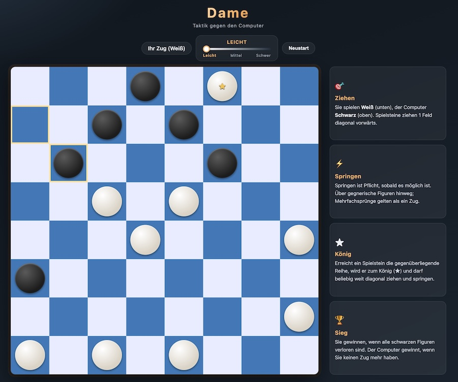

# Dame gegen den Computer

Ein klassisches **Dame-Spiel** im Browser – Sie spielen **Weiß** (unten), der Computer spielt **Schwarz** (oben).



## Features

- **Drei Schwierigkeitsstufen**: Leicht, Mittel und Schwer (mit Minimax-Suche und Alpha-Beta-Pruning)
- **Pflichtsprung** und Mehrfachsprünge
- **König-Regelung**: Erreicht eine Figur die gegenüberliegende Reihe, wird sie zum König (★) und darf beliebig weit diagonal ziehen und springen
- **Animierte Züge**: Spielsteine gleiten vom Ausgangs- zum Zielfeld
- **Responsives Design**: Brett und Regelkästen passen sich dem Bildschirm an

## Steuerung

1. Wählen Sie die Schwierigkeit mit dem Schieberegler
2. Klicken Sie auf einen weißen Stein und dann auf ein markiertes Zielfeld
3. Springen ist Pflicht, sobald es möglich ist
4. Der Computer antwortet nach Ihrem Zug automatisch

## Live-Demo

👉 https://nofonbg.github.io/dame

## Lokal starten

```bash
# Einfach die Datei index.html im Browser öffnen
# oder einen lokalen Server starten:
python3 -m http.server 8000
```

## Dateien

- `index.html` – HTML-Struktur
- `style.css` – Design und Layout
- `script.js` – Spiellogik und KI
